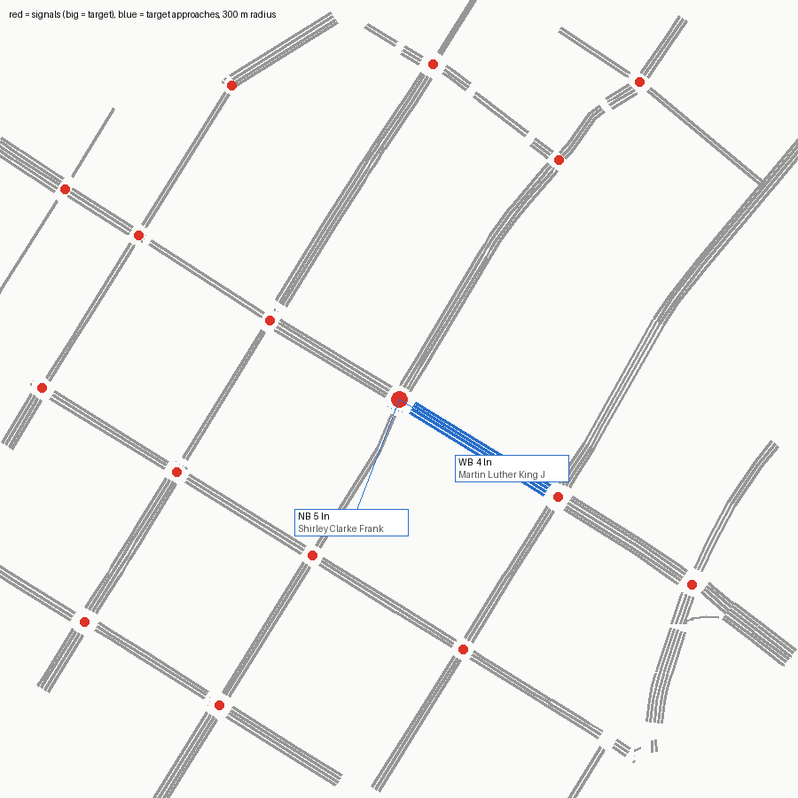

# SUMO network — signal 129 (MLK Drive @ Central Avenue)

Built from OpenStreetMap by `tools/osm_build.py`. ATSPM location 33.75082, -84.38985.

Target junction `69167148` (traffic_light), 2.3 m from the ATSPM location.

## Approaches

| Approach | Street | Heading | Lanes | OSM lanes tag | OSM turn:lanes | Lane use (right→left) | Road upstream |
|---|---|---|---|---|---|---|---|
| NB | Shirley Clarke Franklin Boulevard Southwest | 21° | 5 | 5 | left|none|none|none|none | T T T T L | 126 m |
| WB | Martin Luther King Jr Drive Southwest | 302° | 4 | 4 | none|none|through;right|right | R TR T T | 130 m |

## Flags

- none
- netconvert printed 40 warning(s) (see netconvert.log)

## ATSPM movement → SUMO edges

| ATSPM column | From edge | To edge | Note |
|---|---|---|---|
| WB_T | 630697023#0 | 630644331#0 |  |
| WB_R | 630697023#0 | 580808689#0 |  |
| NB_T | 1052597162#0 | 580808689#0 |  |
| NB_TL | 1052597162#0 | 580808689#0 | shared-lane detector |
| NB_TL | 1052597162#0 | 630644331#0 | shared-lane detector |

Not mapped (not vehicle turning movements): EXIT_NB_T EXIT_WB_T

## Smoke test

One flow per turning movement (120 veh/h each, 10 min) under netconvert's guessed signal program, run to 20 min.

- flows: 4, vehicles loaded 80, inserted 80, still running at 20 min 0
- teleports 0, collisions 0, SUMO warnings 0
- **PASS**

## What this network does not have

- The real signal timing (netconvert guesses a program; real plans: `tools/atspm_plans.py`).
- Lane counts or turn bays that OSM doesn't tag; see Flags. Verify against aerial imagery before trusting capacity results.
- Calibrated demand (the smoke test only checks every movement can be driven).
