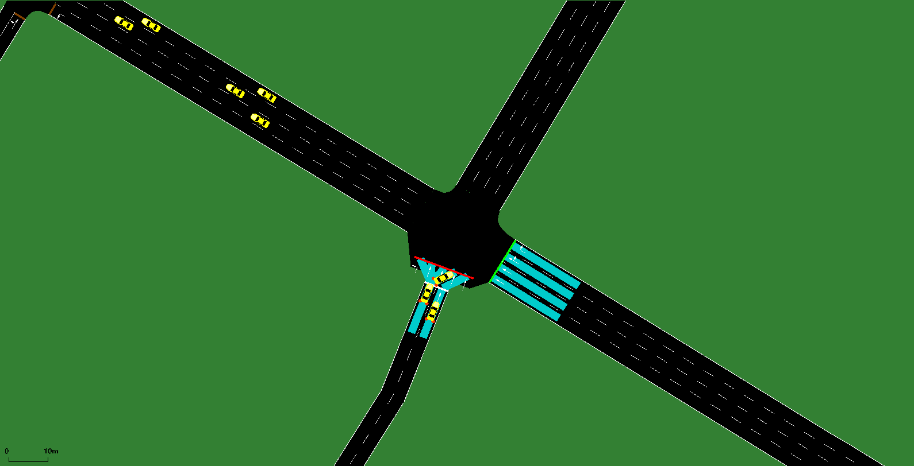

# Simulation — signal 129 (MLK  Drive @  Central Avenue)

Quality-check simulation built by `tools/build_sim.py` from the real data for **2026-10-02**: network = OpenStreetMap (tools/osm_build.py), measured 5-min turning-movement counts, and the real time-of-day signal plans.

```bash
cd intersections/129/sim
sumo-gui -c gui.sumocfg     # 07:45-09:00, press play
sumo -c sim.sumocfg         # full day, headless
```



## Demand (measured counts)

| Movement | Vehicles in the day |
|---|---|
| NB_T | 11364 |
| NB_TL | 3430 |
| WB_R | 830 |
| WB_T | 4316 |

19940 vehicles in 1306 five-minute flows. Each flow starts upstream of the approach and passes the intersection.

## Signal (real plans)

Signal `69167148`. Schedule:

00:00 **A** (80 s) · 05:01 **B** (100 s) · 07:01 **C** (120 s) · 11:01 **D** (100 s) · 14:01 **E** (120 s) · 19:02 **F** (99 s) · 21:02 **D** (100 s)

Phase → movement: `../timing/phase_map.json` (from GDOT's Split Failure chart titles); splits: `../timing/timing_plan_129.md`.

### Actuation parameters

| Phase | Min green (s, measured) | Max green in actuated periods (s) |
|---|---|---|
| P2 | 14.6 | – |
| P4 | 11.1 | – |

## Validation against the recorded signal (2026-10-02)

Vehicle extension chosen: **1.0 s through phases, 2.0 s left-turn phases** (grid 1.0, 2.0, 3.0, 4.0 × 2.0, 3.0, 4.0, 6.0, 8.0), mean absolute error of median green per phase: **2.9 s**.

| Window | Phase | Recorded median green (s) | n | Simulated median green (s) | n |
|---|---|---|---|---|---|
| 08:00 | P2 | 60.1 | 7 | 63.0 | 8 |
| 08:00 | P4 | 48.1 | 7 | 45.0 | 7 |
| 17:00 | P2 | 58.3 | 7 | 61.0 | 8 |
| 17:00 | P4 | 49.8 | 7 | 47.0 | 7 |

## Assumptions and gaps

- ASSUMPTION: shared-lane column NB_TL is split equally between its 2 movements (T, L); the real split is not measured.
- Arrivals: Poisson within each 5-min bin with the measured count (random times, seed 12345); counts per movement per bin are exact.
- Offsets unknown (coordination with neighbouring signals not modelled).
- Max recall (full split every cycle, < 5% gap-outs on the Split Monitor): plan A: P4; plan B: P4; plan C: P4; plan D: P4; plan E: P4; plan F: P4.
- Controller: SUMO NEMA actuated dual ring. Coordinated plans use the real splits as force-offs within the real cycle, phases 2/6 coordinated; other phases gap out / skip on 20 m stop-bar detectors. Vehicle extension 1.0 s through phases, 2.0 s left-turn phases (not published by GDOT; fitted to the recorded greens).
- 15 neighbouring signal(s) in the network area switched off (their timing is unknown); only the target signal is controlled.

## Quality check (07:00-09:30, headless)

- vehicles loaded 3456, inserted 3425, still waiting to enter at 09:30 0, still running 16
- teleports 0 (jams 0), collisions 0, SUMO warnings 15
- mean per trip: waiting 14.9 s, time loss 23.7 s, departure delay 0.5 s
- **PASS** (pass = no teleports, no collisions, no entry backlog at 09:30)
