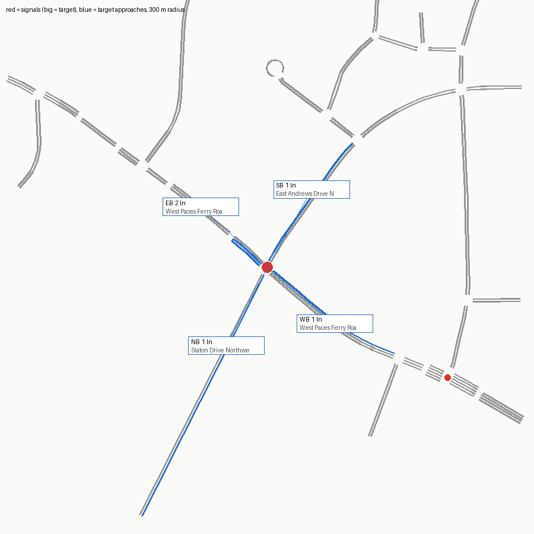

# SUMO network — signal 137 (W. Paces Ferry Rd @ E. Andrews Dr/Slaton Dr)

Built from OpenStreetMap by `tools/osm_build.py`. ATSPM location 33.84166, -84.38459.

Target junction `69545429` (traffic_light), 3.2 m from the ATSPM location.

## Approaches

| Approach | Street | Heading | Lanes | OSM lanes tag | OSM turn:lanes | Lane use (right→left) | Road upstream |
|---|---|---|---|---|---|---|---|
| NB | Slaton Drive Northwest | 27° | 1 | 2 |  | LTR | 333 m |
| EB | West Paces Ferry Road Northwest | 132° | 2 | 3 | left|none | T L | 321 m |
| SB | East Andrews Drive Northwest | 210° | 1 | **missing** |  | LTR | 377 m |
| WB | West Paces Ferry Road Northwest | 310° | 1 | 3 |  | LTR | 225 m |

## Flags

- EB approach (West Paces Ferry Road Northwest) heads 132°, 42° off the compass label; check the label
- WB approach (West Paces Ferry Road Northwest) heads 310°, 40° off the compass label; check the label
- NB approach (Slaton Drive Northwest): two-way way with lanes=2 total and no lanes:forward/backward; per-direction split guessed by netconvert
- SB approach (East Andrews Drive Northwest): OSM way 9273981 has no lanes tag; 1 lane(s) is a netconvert default
- ATSPM counts EB_TR but the OSM EB approach has no 'R' movement
- netconvert printed 6 warning(s) (see netconvert.log)

## ATSPM movement → SUMO edges

| ATSPM column | From edge | To edge | Note |
|---|---|---|---|
| EB_L | -1302258405#1 | -9273981#14 |  |
| EB_TR | -1302258405#1 | -289670475#9 | shared-lane detector |
| WB_L | 289670475#2 | -9269817#8 |  |
| WB_TR | 289670475#2 | 1302258405#0 | shared-lane detector |
| WB_TR | 289670475#2 | -9273981#14 | shared-lane detector |
| NB_L | 9269817#3 | 1302258405#0 |  |
| NB_T | 9269817#3 | -9273981#14 |  |
| NB_R | 9269817#3 | -289670475#9 |  |
| SB_L | 9273981#9 | -289670475#9 |  |
| SB_T | 9273981#9 | -9269817#8 |  |
| SB_R | 9273981#9 | 1302258405#0 |  |

Not mapped (not vehicle turning movements): EXIT_EB_T

## Smoke test

One flow per turning movement (120 veh/h each, 10 min) under netconvert's guessed signal program, run to 20 min.

- flows: 11, vehicles loaded 220, inserted 220, still running at 20 min 0
- teleports 0, collisions 0, SUMO warnings 0
- **PASS**

## What this network does not have

- The real signal timing (netconvert guesses a program; real plans: `tools/atspm_plans.py`).
- Lane counts or turn bays that OSM doesn't tag; see Flags. Verify against aerial imagery before trusting capacity results.
- Calibrated demand (the smoke test only checks every movement can be driven).
