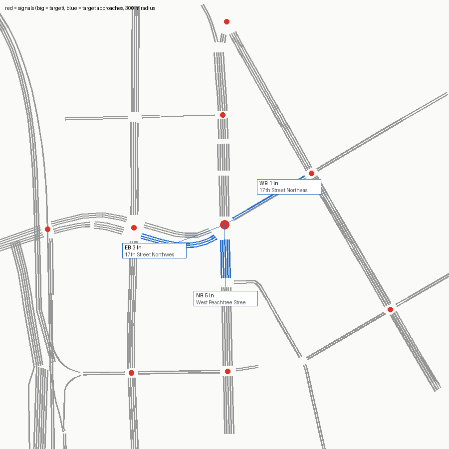

# SUMO network — signal 191 (W. Peachtree St @ 17th St)

Built from OpenStreetMap by `tools/osm_build.py`. ATSPM location 33.79184, -84.38773.

Target junction `69372832` (traffic_light), 5.0 m from the ATSPM location.

## Approaches

| Approach | Street | Heading | Lanes | OSM lanes tag | OSM turn:lanes | Lane use (right→left) | Road upstream |
|---|---|---|---|---|---|---|---|
| NB | West Peachtree Street Northwest | 359° | 5 | 5 |  | TR T T T LT | 171 m |
| EB | 17th Street Northwest | 69° | 3 | 3 | left|left|left;through | LT L L | 113 m |
| WB | 17th Street Northeast | 240° | 1 | 2 |  | TR | 123 m |

## Flags

- WB approach (17th Street Northeast): two-way way with lanes=2 total and no lanes:forward/backward; per-direction split guessed by netconvert
- netconvert printed 14 warning(s) (see netconvert.log)

## ATSPM movement → SUMO edges

| ATSPM column | From edge | To edge | Note |
|---|---|---|---|
| EB_L | 112508109#0 | 629278093#0 |  |
| EB_T | 112508109#0 | 9270296#0 |  |
| EB_TL | 112508109#0 | 9270296#0 | shared-lane detector |
| EB_TL | 112508109#0 | 629278093#0 | shared-lane detector |
| WB_T | -9270296#3 | 26786742#0 |  |
| WB_TR | -9270296#3 | 26786742#0 | shared-lane detector |
| WB_TR | -9270296#3 | 629278093#0 | shared-lane detector |
| NB_T | 73229529#5 | 629278093#0 |  |

## Smoke test

One flow per turning movement (120 veh/h each, 10 min) under netconvert's guessed signal program, run to 20 min.

- flows: 7, vehicles loaded 140, inserted 140, still running at 20 min 0
- teleports 0, collisions 0, SUMO warnings 0
- **PASS**

## What this network does not have

- The real signal timing (netconvert guesses a program; real plans: `tools/atspm_plans.py`).
- Lane counts or turn bays that OSM doesn't tag; see Flags. Verify against aerial imagery before trusting capacity results.
- Calibrated demand (the smoke test only checks every movement can be driven).
