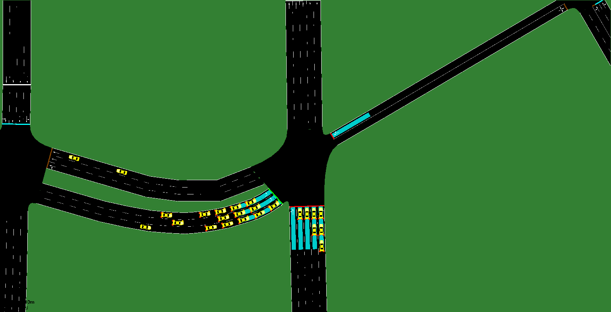

# Simulation — signal 191 (W. Peachtree St  @  17th St)

Quality-check simulation built by `tools/build_sim.py` from the real data for **2026-10-02**: network = OpenStreetMap (tools/osm_build.py), measured 5-min turning-movement counts, and the real time-of-day signal plans.

```bash
cd intersections/191/sim
sumo-gui -c gui.sumocfg     # 07:45-09:00, press play
sumo -c sim.sumocfg         # full day, headless
```



## Demand (measured counts)

| Movement | Vehicles in the day |
|---|---|
| EB_L | 5523 |
| EB_T | 2787 |
| EB_TL | 3577 |
| NB_T | 15568 |
| WB_T | 3201 |
| WB_TR | 1104 |

31760 vehicles in 2109 five-minute flows. Each flow starts upstream of the approach and passes the intersection.

## Signal (real plans)

Signal `69372832`. Schedule:

00:00 **A** (80 s) · 05:01 **B** (100 s) · 07:01 **C** (120 s) · 09:01 **B** (100 s) · 14:01 **D** (120 s) · 19:02 **E** (100 s) · 21:02 **B** (100 s)

Phase → movement: `../timing/phase_map.json` (from GDOT's Split Failure chart titles); splits: `../timing/timing_plan_191.md`.

### Actuation parameters

| Phase | Min green (s, measured) | Max green in actuated periods (s) |
|---|---|---|
| P2 | 10.2 | – |
| P3 | 5.1 | – |
| P4 | 7.8 | – |

## Validation against the recorded signal (2026-10-02)

Vehicle extension chosen: **1.0 s through phases, 2.0 s left-turn phases** (grid 1.0, 2.0, 3.0, 4.0 × 2.0, 3.0, 4.0, 6.0, 8.0), mean absolute error of median green per phase: **0.9 s**.

| Window | Phase | Recorded median green (s) | n | Simulated median green (s) | n |
|---|---|---|---|---|---|
| 08:00 | P2 | 31.0 | 7 | 32.0 | 8 |
| 08:00 | P3 | 47.3 | 8 | 47.0 | 7 |
| 08:00 | P4 | 23.2 | 7 | 21.0 | 8 |
| 08:00 | P6 | – | 0 | 32.0 | 8 |
| 17:00 | P2 | 45.5 | 7 | 46.0 | 8 |
| 17:00 | P3 | 31.9 | 8 | 32.0 | 7 |
| 17:00 | P4 | 23.3 | 7 | 22.0 | 8 |
| 17:00 | P6 | – | 0 | 46.0 | 8 |

## Assumptions and gaps

- ASSUMPTION: shared-lane column EB_TL is split equally between its 2 movements (T, L); the real split is not measured.
- ASSUMPTION: shared-lane column WB_TR is split equally between its 2 movements (T, R); the real split is not measured.
- Arrivals: Poisson within each 5-min bin with the measured count (random times, seed 12345); counts per movement per bin are exact.
- Plan A: phase(s) [10] (above 8) are not modelled; ring time they occupy is red.
- Plan B: phase(s) [10] (above 8) are not modelled; ring time they occupy is red.
- Plan C: phase(s) [10] (above 8) are not modelled; ring time they occupy is red.
- Plan D: phase(s) [10] (above 8) are not modelled; ring time they occupy is red.
- Plan E: phase(s) [10] (above 8) are not modelled; ring time they occupy is red.
- Yellow/red clearance not measured for phase(s) [3, 6]: defaults 3.5 s / 2.0 s used.
- Offsets unknown (coordination with neighbouring signals not modelled).
- Max recall (full split every cycle, < 5% gap-outs on the Split Monitor): plan A: P3, P4; plan B: P3, P4; plan C: P3, P4; plan D: P3, P4; plan E: P3, P4.
- Controller: SUMO NEMA actuated dual ring. Coordinated plans use the real splits as force-offs within the real cycle, phases 2/6 coordinated; other phases gap out / skip on 20 m stop-bar detectors. Vehicle extension 1.0 s through phases, 2.0 s left-turn phases (not published by GDOT; fitted to the recorded greens).
- 8 neighbouring signal(s) in the network area switched off (their timing is unknown); only the target signal is controlled.

## Quality check (07:00-09:30, headless)

- vehicles loaded 4053, inserted 4008, still waiting to enter at 09:30 0, still running 12
- teleports 0 (jams 0), collisions 0, SUMO warnings 5
- mean per trip: waiting 30.6 s, time loss 39.6 s, departure delay 2.5 s
- **PASS** (pass = no teleports, no collisions, no entry backlog at 09:30)
