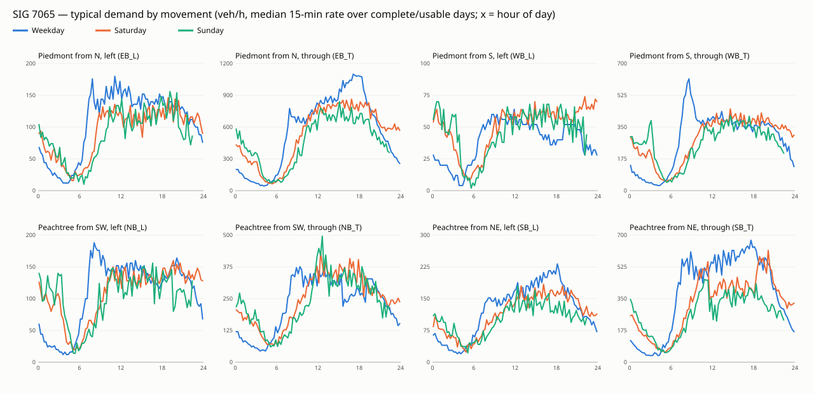

# SIG 7065 dataset — 2026-07-06 to 2026-10-03 (90 days)

Processed from GDOT ATSPM exports (`../counts/tmc_7065_5min.csv`, `../timing/timing_plan_7065.json`) by `tools/dataset_7065.py`. Counts are used as recorded; sensor-outage bins are excluded, never filled.

## Day quality

complete = no outage bin · usable = ≤ 30 min of outage between 06:00 and 22:00 · suspect = a movement reads 0 for ≥ 2 h of daytime while the others count · bad = more daytime outage · missing = no export

| Day type | complete | usable | suspect | bad | missing |
|---|---|---|---|---|---|
| weekday | 39 | 12 | 2 | 11 | 0 |
| saturday | 12 | 0 | 0 | 0 | 1 |
| sunday | 0 | 4 | 0 | 8 | 0 |
| holiday | 0 | 1 | 0 | 0 | 0 |

Per-day details: `days.csv`. Chart: `profiles/daily_totals.svg`.

## Typical demand

Median 15-minute counts per movement: `profiles/<daytype>_15min_median.csv`.

## PM peak hour (busiest rolling hour 15:00–19:00, all movements)

| Day type | days | median veh/h | min | max | typical start |
|---|---|---|---|---|---|
| weekday | 51 | 2972 | 2768 | 3684 | 17:20 |
| saturday | 12 | 2618 | 2328 | 3248 | 18:00 |
| sunday | 4 | 2294 | 2270 | 2558 | 15:00 |
| holiday | 1 | 2183 | 2183 | 2183 | 15:35 |

## GDOT timing schedules

Plans read: A (160 s), B (160 s), C (180 s), D (130 s), E (120 s), F (160 s), G (140 s), H (130 s), I (128 s), J (119 s), K (165 s), L (162 s), M (128 s), N (188 s), O (136 s), P (176 s), Q (188 s), R (170 s), S (168 s), T (131 s), U (160 s), Actuated ( s). Flagged reads (rings don't close or partly read from force-off dots): I, J, K, L, M, N, O, P, Q, R, S, T, U.

**weekday** — 64 days, 20 distinct schedule(s):
- 39 day(s): `00:00 E 06:15 A 13:30 B 15:30 C 19:00 B 19:30 D 21:45 E`
- 3 day(s): `00:00 E 06:15 A 13:30 B 15:30 C 19:00 Q 19:30 D 21:45 E`
- 2 day(s): `00:00 E 06:15 A 13:30 B 15:30 C 19:00 L 19:30 D 21:45 E`
- 2 day(s): `06:15 A 13:30 B 15:30 C 19:00 B 19:30 D 21:45 M`

**saturday** — 12 days, 2 distinct schedule(s):
- 11 day(s): `00:00 E 08:15 G 11:30 F 18:30 G 20:45 H`
- 1 day(s): `00:00 E 08:15 G 11:30 F 21:10 H`

**sunday** — 12 days, 5 distinct schedule(s):
- 5 day(s): `00:00 E 09:15 G 11:30 F 20:30 H`
- 3 day(s): `00:00 E 20:30 H`
- 2 day(s): `00:00 E 11:30 F 20:30 H`
- 1 day(s): `20:30 H`

**holiday** — 1 days, 1 distinct schedule(s):
- 1 day(s): `08:15 G 11:30 F 18:30 G 20:45 H`

Days without a readable schedule: 2026-07-25.

## Interpretation (checked 2026-10-08)

- **Real GDOT plans: 8.** Weekday A–E (unchanged from the earlier 5-day read: same letters, same splits) and
  weekend **F (160 s), G (140 s), H (130 s)**, new in this pull. Spot-checked against the Sat Sep 26 Split
  Monitor chart: controller plans 47 / 40 / 42 / 40 / 48 at 00:00 / 08:15 / 11:30 / 18:30 / 20:45 =
  E / G / F / G / H, programmed P2 splits 50 / 47 / 55 / 50 s as read.
- **Plans I–U are failed reads**, all flagged by the reader's own ring check (mostly short bands at
  plan changeovers, e.g. the 19:00–19:30 slot or a Monday's first band carried over from Sunday). When a
  simulated day uses one, `tools/build_sim.py` substitutes the verified plan read for the same time slot on
  another day (existing rule) — nothing is guessed.
- **Weekday schedule is stable:** 39 of 64 weekdays read exactly `E 06:15 A 13:30 B 15:30 C 19:00 B 19:30 D
  21:45 E`; the rest differ only by a flagged changeover band.
- **Sundays are mostly unusable** (8 of 12 have long daytime outages); Saturdays are all complete except
  Jul 25 (no export).
- **Suspect detectors:** Jul 6 (EB_T and WB_L read 0 for 16 h of daytime) and Jul 7 (same pair, 3 h 15 min).
  Excluded.

## Proposed split (weekdays, chronological — test days come after everything used for training)

51 good weekdays (complete or usable; Labor Day and the two suspect days excluded):

| Set | Days | Dates | Use |
|---|---|---|---|
| Train / design | 31 | Jul 10 – Aug 31 | RL training, Webster design (busiest PM hour), any tuning |
| Validation | 10 | Sep 1 – Sep 16 | RL seed / checkpoint selection |
| Test | 10 | Sep 17 – Oct 2 | final comparison and significance tests — touched once |
| Weekend test (separate) | 12 Saturdays | Jul 11 – Oct 3 | generalisation to weekend plans F/G/H; reported separately |

Real timing on each test day uses that day's own GDOT schedule read from its Split Monitor chart.
