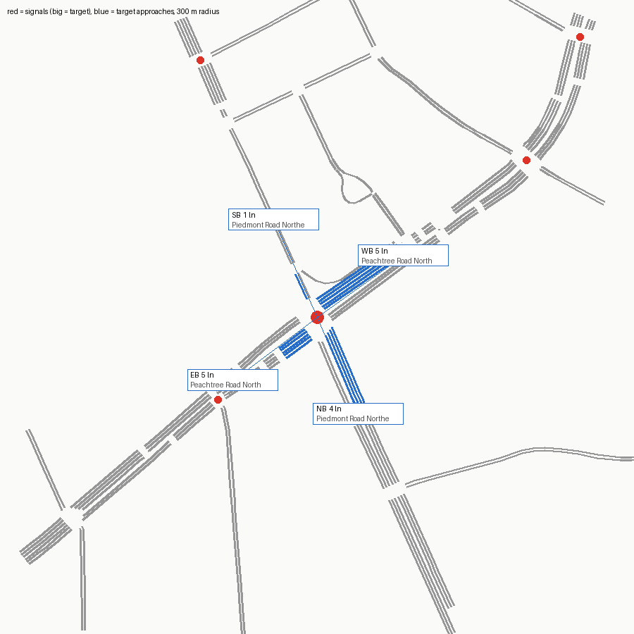

# SUMO network — signal 7065 (SR 141 @ SR 237)

Built from OpenStreetMap by `tools/osm_build.py`. ATSPM location 33.8437, -84.3714.

Target junction `cluster_69536528_69537103` (traffic_light), 2.7 m from the ATSPM location.

## Approaches

| Approach | Street | Heading | Lanes | OSM lanes tag | OSM turn:lanes | Lane use (right→left) | Road upstream |
|---|---|---|---|---|---|---|---|
| NB | Piedmont Road Northeast | 337° | 4 | 4 | left|through|through|through | R T L LU | 291 m |
| EB | Peachtree Road Northeast | 53° | 5 | 5 | left|left||| | R T T T L | 92 m |
| SB | Piedmont Road Northeast | 156° | 1 | **missing** |  | LTR | 230 m |
| WB | Peachtree Road Northeast | 235° | 5 | 5 | left|left||| | T T T L L | 194 m |

## Flags

- SB approach (Piedmont Road Northeast): OSM way 525767115 has no lanes tag; 1 lane(s) is a netconvert default
- EB approach has only 92 m of road before the network edge or the next signal (little queue space)
- netconvert printed 15 warning(s) (see netconvert.log)

## ATSPM movement → SUMO edges

| ATSPM column | From edge | To edge | Note |
|---|---|---|---|
| EB_L | 96433201#0 | 525767115#0 |  |
| EB_T | 96433201#0 | 1049518251#0 |  |
| WB_L | 1153256544#1 | 715642215#0 |  |
| WB_T | 1153256544#1 | 1474278653#0 |  |
| NB_L | 715642217#0 | 1474278653#0 |  |
| NB_T | 715642217#0 | 525767115#0 |  |
| SB_L | -525767115#1 | 1049518251#0 |  |
| SB_T | -525767115#1 | 715642215#0 |  |

## Smoke test

One flow per turning movement (120 veh/h each, 10 min) under netconvert's guessed signal program, run to 20 min.

- flows: 11, vehicles loaded 220, inserted 220, still running at 20 min 0
- teleports 0, collisions 0, SUMO warnings 0
- **PASS**

## What this network does not have

- The real signal timing (netconvert guesses a program; real plans: `tools/atspm_plans.py`).
- Lane counts or turn bays that OSM doesn't tag; see Flags. Verify against aerial imagery before trusting capacity results.
- Calibrated demand (the smoke test only checks every movement can be driven).
