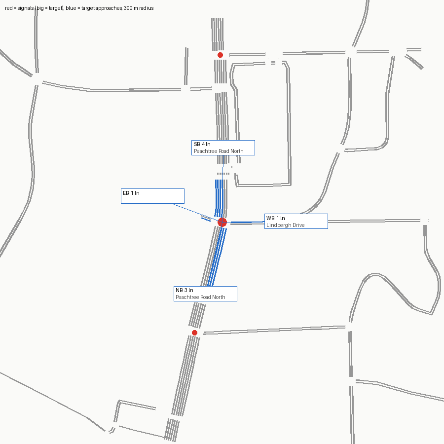

# SUMO network — signal 7100 (SR 9 @ Lindbergh Drive)

Built from OpenStreetMap by `tools/osm_build.py`. ATSPM location 33.82286, -84.38749.

Target junction `69536974` (traffic_light), 1.3 m from the ATSPM location.

## Approaches

| Approach | Street | Heading | Lanes | OSM lanes tag | OSM turn:lanes | Lane use (right→left) | Road upstream |
|---|---|---|---|---|---|---|---|
| NB | Peachtree Road Northeast | 13° | 3 | 6 |  | T T L | 145 m |
| EB |  | 110° | 1 | **missing** |  | LTR | 16 m |
| SB | Peachtree Road Northeast | 181° | 4 | 6 | left||| | T T T L | 197 m |
| WB | Lindbergh Drive | 270° | 1 | **missing** |  | LTR | 265 m |

## Flags

- NB approach (Peachtree Road Northeast): two-way way with lanes=6 total and no lanes:forward/backward; per-direction split guessed by netconvert
- WB approach (Lindbergh Drive): OSM way 9274711 has no lanes tag; 1 lane(s) is a netconvert default
- EB approach (561687258#0): OSM way 561687258 has no lanes tag; 1 lane(s) is a netconvert default
- EB approach has only 16 m of road before the network edge or the next signal (little queue space)
- GDOT counts an approach missing from OSM roads; service road(s) 561687258 touching the junction (driveways in OSM) were included as legs
- ATSPM counts NB_TR but the OSM NB approach has no 'R' movement
- ATSPM counts SB_TR but the OSM SB approach has no 'R' movement
- netconvert printed 6 warning(s) (see netconvert.log)

## ATSPM movement → SUMO edges

| ATSPM column | From edge | To edge | Note |
|---|---|---|---|
| EB_TL | 561687258#0 | 9274711#0 | shared-lane detector |
| EB_TL | 561687258#0 | -1315020083#1 | shared-lane detector |
| WB_L | -9274711#1 | 1315020084#0 |  |
| WB_TL | -9274711#1 | -561687258#1 | shared-lane detector |
| WB_TL | -9274711#1 | 1315020084#0 | shared-lane detector |
| WB_R | -9274711#1 | -1315020083#1 |  |
| NB_T | -1302256482#4 | -1315020083#1 |  |
| NB_TR | -1302256482#4 | -1315020083#1 | shared-lane detector |
| SB_L | 1315020083#0 | 9274711#0 |  |
| SB_T | 1315020083#0 | 1315020084#0 |  |
| SB_TR | 1315020083#0 | 1315020084#0 | shared-lane detector |

## Smoke test

One flow per turning movement (120 veh/h each, 10 min) under netconvert's guessed signal program, run to 20 min.

- flows: 10, vehicles loaded 200, inserted 200, still running at 20 min 0
- teleports 0, collisions 0, SUMO warnings 0
- **PASS**

## What this network does not have

- The real signal timing (netconvert guesses a program; real plans: `tools/atspm_plans.py`).
- Lane counts or turn bays that OSM doesn't tag; see Flags. Verify against aerial imagery before trusting capacity results.
- Calibrated demand (the smoke test only checks every movement can be driven).
