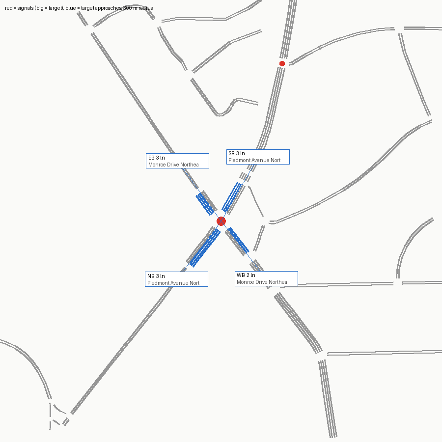

# SUMO network — signal 7130 (SR 237 @ Monroe Drive)

Built from OpenStreetMap by `tools/osm_build.py`. ATSPM location 33.79711, -84.36897.

Target junction `69589641` (traffic_light), 2.5 m from the ATSPM location.

## Approaches

| Approach | Street | Heading | Lanes | OSM lanes tag | OSM turn:lanes | Lane use (right→left) | Road upstream |
|---|---|---|---|---|---|---|---|
| NB | Piedmont Avenue Northeast | 37° | 3 | 5 | left|| | T T L | 353 m |
| EB | Monroe Drive Northeast | 144° | 3 | 5 | left|none|none | T T L | 339 m |
| SB | Piedmont Avenue Northeast | 210° | 3 | 5 | left|none|none | T T L | 216 m |
| WB | Monroe Drive Northeast | 322° | 2 | 4 |  | TR LT | 315 m |

## Flags

- EB approach (Monroe Drive Northeast) heads 144°, 54° off the compass label; check the label
- WB approach (Monroe Drive Northeast) heads 322°, 52° off the compass label; check the label
- WB approach (Monroe Drive Northeast): two-way way with lanes=4 total and no lanes:forward/backward; per-direction split guessed by netconvert
- netconvert printed 5 warning(s) (see netconvert.log)

## ATSPM movement → SUMO edges

| ATSPM column | From edge | To edge | Note |
|---|---|---|---|
| EB_L | -1446233301 | 1377424634#0 |  |
| WB_L | 1355126856#22 | -1377416116#4 |  |
| NB_L | 1377416116#0 | 1446233300#0 |  |
| SB_L | -1377424634#1 | -1355126856#23 |  |

Not mapped (not vehicle turning movements): EXIT_EB_T EXIT_NB_T EXIT_SB_T EXIT_WB_T

## Smoke test

One flow per turning movement (120 veh/h each, 10 min) under netconvert's guessed signal program, run to 20 min.

- flows: 9, vehicles loaded 180, inserted 180, still running at 20 min 0
- teleports 0, collisions 0, SUMO warnings 0
- **PASS**

## What this network does not have

- The real signal timing (netconvert guesses a program; real plans: `tools/atspm_plans.py`).
- Lane counts or turn bays that OSM doesn't tag; see Flags. Verify against aerial imagery before trusting capacity results.
- Calibrated demand (the smoke test only checks every movement can be driven).
