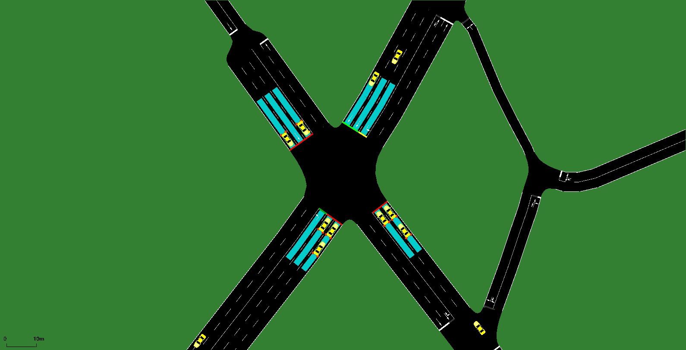

# Simulation — signal 7130 (SR 237  @  Monroe Drive)

Quality-check simulation built by `tools/build_sim.py` from the real data for **2026-10-02**: network = OpenStreetMap (tools/osm_build.py), measured 5-min turning-movement counts, and the real time-of-day signal plans.

```bash
cd intersections/7130/sim
sumo-gui -c gui.sumocfg     # 07:45-09:00, press play
sumo -c sim.sumocfg         # full day, headless
```



## Demand (measured counts)

| Movement | Vehicles in the day |
|---|---|
| EB_L | 1994 |
| EB_T* | 2068 |
| NB_L | 1154 |
| NB_T* | 7851 |
| SB_L | 2786 |
| SB_T* | 9843 |
| WB_L | 1321 |
| WB_T* | 5661 |

32678 vehicles in 2114 five-minute flows. Each flow starts upstream of the approach and passes the intersection.

## Signal (real plans)

Signal `69589641`. Schedule:

00:00 **Actuated** (77 s) · 07:01 **A** (140 s) · 08:15 **B** (140 s) · 10:14 **C** (140 s) · 14:46 **D** (160 s)

Phase → movement: `../timing/phase_map.json` (from GDOT's Split Failure chart titles); splits: `../timing/timing_plan_7130.md`.

### Actuation parameters

| Phase | Min green (s, measured) | Max green in actuated periods (s) |
|---|---|---|
| P1 | 4.2 | 15 (max-out dots) |
| P2 | 12.0 | 30 (max-out dots) |
| P3 | 3.5 | 14 (max-out dots) |
| P4 | 6.0 | 30 (max-out dots) |
| P5 | 4.2 | 20 (max-out dots) |
| P6 | 12.0 | 30 (max-out dots) |
| P7 | 4.0 | 15 (max-out dots) |
| P8 | 6.0 | 30 (max-out dots) |

## Validation against the recorded signal (2026-10-02)

Vehicle extension chosen: **4.0 s through phases, 8.0 s left-turn phases** (grid 1.0, 2.0, 3.0, 4.0 × 2.0, 3.0, 4.0, 6.0, 8.0), mean absolute error of median green per phase: **5.8 s**.

| Window | Phase | Recorded median green (s) | n | Simulated median green (s) | n |
|---|---|---|---|---|---|
| 08:00 | P1 | 11.3 | 4 | 11.0 | 6 |
| 08:00 | P2 | 64.1 | 5 | 70.0 | 7 |
| 08:00 | P3 | 9.6 | 6 | 9.0 | 5 |
| 08:00 | P4 | 34.6 | 6 | 32.0 | 6 |
| 08:00 | P5 | 24.1 | 6 | 14.0 | 5 |
| 08:00 | P6 | 53.3 | 6 | 66.0 | 7 |
| 08:00 | P7 | 20.0 | 6 | 24.0 | 6 |
| 08:00 | P8 | 24.9 | 6 | 16.0 | 6 |
| 17:00 | P1 | 14.0 | 4 | 12.0 | 4 |
| 17:00 | P2 | 85.0 | 5 | 83.0 | 6 |
| 17:00 | P3 | 15.6 | 4 | 15.0 | 5 |
| 17:00 | P4 | 30.1 | 5 | 29.0 | 6 |
| 17:00 | P5 | 23.3 | 5 | 17.0 | 5 |
| 17:00 | P6 | 43.9 | 6 | 79.0 | 6 |
| 17:00 | P7 | 19.9 | 5 | 20.0 | 6 |
| 17:00 | P8 | 23.3 | 5 | 23.0 | 6 |

## Assumptions and gaps

- DERIVED: NB through = EXIT_NB_T (exit-lane count leaving NB) minus the counted movements into that leg; an upper bound (uncounted right turns into the leg are included).
- DERIVED: EB through = EXIT_EB_T (exit-lane count leaving EB) minus the counted movements into that leg; an upper bound (uncounted right turns into the leg are included).
- DERIVED: SB through = EXIT_SB_T (exit-lane count leaving SB) minus the counted movements into that leg; an upper bound (uncounted right turns into the leg are included).
- DERIVED: WB through = EXIT_WB_T (exit-lane count leaving WB) minus the counted movements into that leg; an upper bound (uncounted right turns into the leg are included).
- Arrivals: Poisson within each 5-min bin with the measured count (random times, seed 12345); counts per movement per bin are exact.
- Plan D: phase(s) [9] (above 8) are not modelled; ring time they occupy is red.
- Offsets unknown (coordination with neighbouring signals not modelled).
- 07:01-08:15: plan E is an unverified read on 2026-10-02; used plan A, read for the same time slot on 2026-09-29.
- Plan D: rings don't add up to one cycle (unverified read or an unmodelled phase); slack given to P6 +25 s so SUMO's controller accepts it.
- Plan E: rings don't add up to one cycle (unverified read or an unmodelled phase); slack given to P6 +25 s so SUMO's controller accepts it.
- Max recall (full split every cycle, < 5% gap-outs on the Split Monitor): plan A: P1; plan D: P8.
- 'Actuated' periods (Free or uncoordinated) run actuated, uncoordinated, with max greens from Split Monitor max-outs where seen, otherwise the 95th percentile of observed phase times (a lower bound on the real max).
- Controller: SUMO NEMA actuated dual ring. Coordinated plans use the real splits as force-offs within the real cycle, phases 2/6 coordinated; other phases gap out / skip on 20 m stop-bar detectors. Vehicle extension 4.0 s through phases, 8.0 s left-turn phases (not published by GDOT; fitted to the recorded greens).
- 1 neighbouring signal(s) in the network area switched off (their timing is unknown); only the target signal is controlled.

## Quality check (07:00-09:30, headless)

- vehicles loaded 4383, inserted 4338, still waiting to enter at 09:30 0, still running 28
- teleports 0 (jams 0), collisions 0, SUMO warnings 22
- mean per trip: waiting 26.6 s, time loss 34.2 s, departure delay 0.5 s
- **PASS** (pass = no teleports, no collisions, no entry backlog at 09:30)
