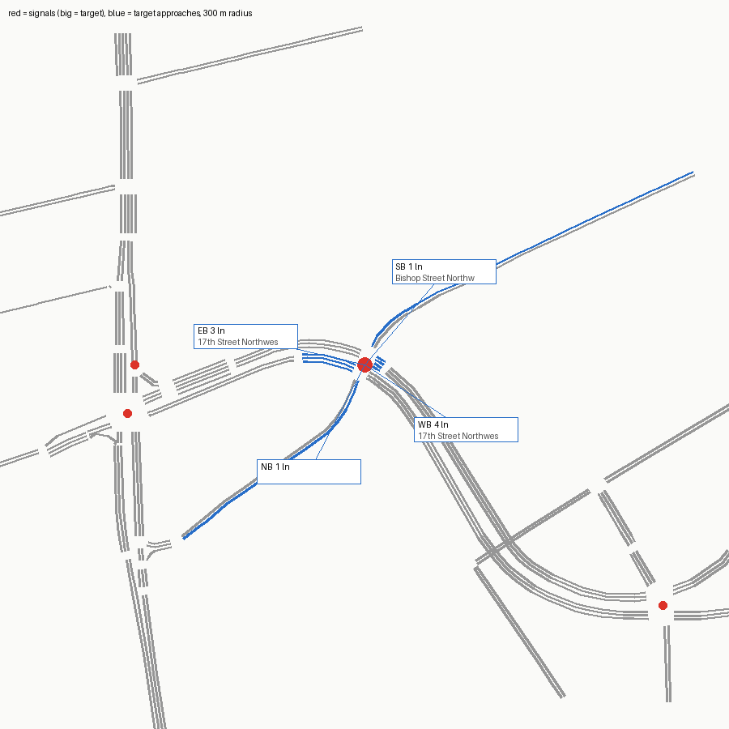

# SUMO network — signal 7151 (17th Street @ Bishop Street)

Built from OpenStreetMap by `tools/osm_build.py`. ATSPM location 33.79166, -84.40561.

Target junction `cluster_1278558749_283201123` (traffic_light), 1.5 m from the ATSPM location.

## Approaches

| Approach | Street | Heading | Lanes | OSM lanes tag | OSM turn:lanes | Lane use (right→left) | Road upstream |
|---|---|---|---|---|---|---|---|
| NB |  | 27° | 1 | 2 |  | LTR | 243 m |
| EB | 17th Street Northwest | 103° | 3 | 3 | left|none|none | T T L | 189 m |
| SB | Bishop Street Northwest | 221° | 1 | **missing** |  | LTR | 334 m |
| WB | 17th Street Northwest | 303° | 4 | 4 | reverse||| | TR T T U | 338 m |

## Flags

- NB approach (678600538#0): two-way way with lanes=2 total and no lanes:forward/backward; per-direction split guessed by netconvert
- SB approach (Bishop Street Northwest) heads 221°, 41° off the compass label; check the label
- SB approach (Bishop Street Northwest): OSM way 9267696 has no lanes tag; 1 lane(s) is a netconvert default
- manual connection fixes applied from manual.con.xml (see the comments in it)
- netconvert printed 16 warning(s) (see netconvert.log)

## ATSPM movement → SUMO edges

| ATSPM column | From edge | To edge | Note |
|---|---|---|---|
| EB_L | 1051747987#0 | -9267696#19 |  |
| EB_T | 1051747987#0 | 1051747988#0 |  |
| WB_T | 1114817997#0 | 25958945#0 |  |
| WB_TR | 1114817997#0 | 25958945#0 | shared-lane detector |
| WB_TR | 1114817997#0 | -9267696#19 | shared-lane detector |
| NB_TL | 678600538#0 | -9267696#19 | shared-lane detector |
| NB_TL | 678600538#0 | 25958945#0 | shared-lane detector |
| SB_L | 9267696#3 | 1051747988#0 |  |
| SB_TR | 9267696#3 | -678600538#6 | shared-lane detector |
| SB_TR | 9267696#3 | 25958945#0 | shared-lane detector |

## Smoke test

One flow per turning movement (120 veh/h each, 10 min) under netconvert's guessed signal program, run to 20 min.

- flows: 10, vehicles loaded 200, inserted 200, still running at 20 min 0
- teleports 0, collisions 0, SUMO warnings 0
- **PASS**

## What this network does not have

- The real signal timing (netconvert guesses a program; real plans: `tools/atspm_plans.py`).
- Lane counts or turn bays that OSM doesn't tag; see Flags. Verify against aerial imagery before trusting capacity results.
- Calibrated demand (the smoke test only checks every movement can be driven).
