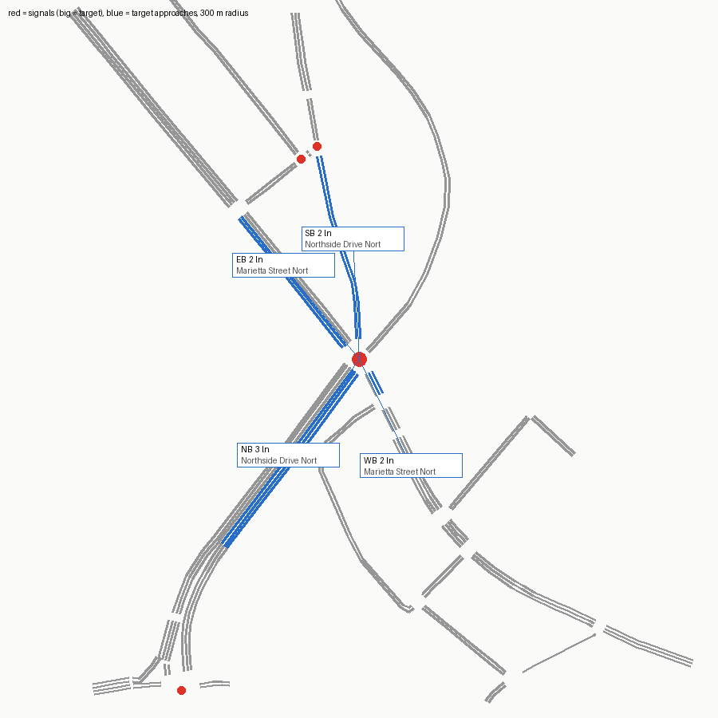

# SUMO network — signal 7153 (SR 3 @ Marietta Street)

Built from OpenStreetMap by `tools/osm_build.py`. ATSPM location 33.77589, -84.40703.

Target junction `69116075` (traffic_light), 2.2 m from the ATSPM location.

## Approaches

| Approach | Street | Heading | Lanes | OSM lanes tag | OSM turn:lanes | Lane use (right→left) | Road upstream |
|---|---|---|---|---|---|---|---|
| NB | Northside Drive Northwest | 36° | 3 | 6 | left|| | T T L | 323 m |
| EB | Marietta Street Northwest | 141° | 2 | 4 |  | R T | 382 m |
| SB | Northside Drive Northwest | 177° | 2 | 2 |  | TU L | 172 m |
| WB | Marietta Street Northwest | 334° | 2 | 3 | left|through;right | TR L | 355 m |

## Flags

- EB approach (Marietta Street Northwest) heads 141°, 51° off the compass label; check the label
- EB approach (Marietta Street Northwest): two-way way with lanes=4 total and no lanes:forward/backward; per-direction split guessed by netconvert
- WB approach (Marietta Street Northwest) heads 334°, 64° off the compass label; check the label
- manual connection fixes applied from manual.con.xml (see the comments in it)
- netconvert printed 38 warning(s) (see netconvert.log)

## ATSPM movement → SUMO edges

| ATSPM column | From edge | To edge | Note |
|---|---|---|---|
| EB_T | -953412628#5 | -1428950040#3 |  |
| EB_TR | -953412628#5 | -1428950040#3 | shared-lane detector |
| EB_TR | -953412628#5 | -111877313#1 | shared-lane detector |
| WB_L | 1428950040#2 | -111877313#1 |  |
| WB_TR | 1428950040#2 | 953412628#0 | shared-lane detector |
| WB_TR | 1428950040#2 | 1387067902 | shared-lane detector |
| NB_L | 111877312 | 953412628#0 |  |
| NB_T | 111877312 | 1387067902 |  |
| SB_L | 119948082#1 | 1387067902 |  |
| SB_T | 119948082#1 | -111877313#1 |  |
| SB_T | 119948082#1 | -1428950040#3 |  |

## Smoke test

One flow per turning movement (120 veh/h each, 10 min) under netconvert's guessed signal program, run to 20 min.

- flows: 10, vehicles loaded 200, inserted 200, still running at 20 min 0
- teleports 0, collisions 0, SUMO warnings 0
- **PASS**

## What this network does not have

- The real signal timing (netconvert guesses a program; real plans: `tools/atspm_plans.py`).
- Lane counts or turn bays that OSM doesn't tag; see Flags. Verify against aerial imagery before trusting capacity results.
- Calibrated demand (the smoke test only checks every movement can be driven).
