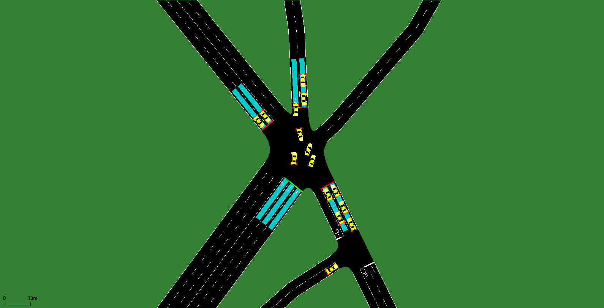

# Simulation — signal 7153 (SR 3  @  Marietta Street)

Quality-check simulation built by `tools/build_sim.py` from the real data for **2026-10-02**: network = OpenStreetMap (tools/osm_build.py), measured 5-min turning-movement counts, and the real time-of-day signal plans.

```bash
cd intersections/7153/sim
sumo-gui -c gui.sumocfg     # 07:45-09:00, press play
sumo -c sim.sumocfg         # full day, headless
```



## Demand (measured counts)

| Movement | Vehicles in the day |
|---|---|
| EB_T | 2048 |
| EB_TR | 3996 |
| NB_L | 1629 |
| NB_T | 1432 |
| SB_L | 1698 |
| SB_T | 5874 |
| WB_L | 966 |
| WB_TR | 6317 |

23960 vehicles in 3013 five-minute flows. Each flow starts upstream of the approach and passes the intersection.

## Signal (real plans)

Signal `69116075`. Schedule:

00:00 **E** (120 s) · 07:01 **A** (140 s) · 09:30 **B** (140 s) · 15:01 **C** (160 s) · 18:01 **D** (140 s) · 19:02 **E** (120 s)

Phase → movement: `../timing/phase_map.json` (from GDOT's Split Failure chart titles); splits: `../timing/timing_plan_7153.md`.

### Actuation parameters

| Phase | Min green (s, measured) | Max green in actuated periods (s) |
|---|---|---|
| P1 | 5.0 | – |
| P2 | 12.0 | – |
| P3 | 5.1 | – |
| P4 | 7.8 | – |
| P5 | 6.8 | – |
| P6 | 12.0 | – |
| P8 | 7.8 | – |

## Validation against the recorded signal (2026-10-02)

Vehicle extension chosen: **4.0 s through phases, 4.0 s left-turn phases** (grid 1.0, 2.0, 3.0, 4.0 × 2.0, 3.0, 4.0, 6.0, 8.0), mean absolute error of median green per phase: **2.8 s**.

| Window | Phase | Recorded median green (s) | n | Simulated median green (s) | n |
|---|---|---|---|---|---|
| 08:00 | P1 | 13.1 | 7 | 14.0 | 7 |
| 08:00 | P2 | 66.9 | 6 | 70.0 | 7 |
| 08:00 | P3 | 8.8 | 3 | 9.0 | 3 |
| 08:00 | P4 | 29.2 | 6 | 22.0 | 6 |
| 08:00 | P5 | 12.3 | 7 | 21.0 | 7 |
| 08:00 | P6 | 67.7 | 6 | 62.0 | 7 |
| 08:00 | P8 | 43.8 | 6 | 36.0 | 6 |
| 17:00 | P1 | 20.7 | 5 | 21.0 | 6 |
| 17:00 | P2 | 61.8 | 5 | 64.0 | 6 |
| 17:00 | P3 | 8.7 | 6 | 9.0 | 5 |
| 17:00 | P4 | 43.0 | 5 | 43.0 | 6 |
| 17:00 | P5 | 18.1 | 4 | 18.0 | 6 |
| 17:00 | P6 | 66.0 | 5 | 66.0 | 6 |
| 17:00 | P8 | 57.5 | 5 | 55.0 | 5 |

## Assumptions and gaps

- ASSUMPTION: shared-lane column EB_TR is split equally between its 2 movements (T, R); the real split is not measured.
- ASSUMPTION: shared-lane column WB_TR is split equally between its 2 movements (T, R); the real split is not measured.
- ASSUMPTION: shared-lane column SB_T is split equally between its 2 movements (T, T); the real split is not measured.
- Arrivals: Poisson within each 5-min bin with the measured count (random times, seed 12345); counts per movement per bin are exact.
- Offsets unknown (coordination with neighbouring signals not modelled).
- 00:00-07:01 has no readable plan (carried over from the previous day); ASSUMED the day's last plan (E).
- Plan B: rings don't add up to one cycle (unverified read or an unmodelled phase); slack given to P6 +1 s so SUMO's controller accepts it.
- Max recall (full split every cycle, < 5% gap-outs on the Split Monitor): plan A: P1; plan B: P1; plan C: P1; plan D: P1, P3; plan E: P1.
- Controller: SUMO NEMA actuated dual ring. Coordinated plans use the real splits as force-offs within the real cycle, phases 2/6 coordinated; other phases gap out / skip on 20 m stop-bar detectors. Vehicle extension 4.0 s through phases, 4.0 s left-turn phases (not published by GDOT; fitted to the recorded greens).
- 2 neighbouring signal(s) in the network area switched off (their timing is unknown); only the target signal is controlled.

## Quality check (07:00-09:30, headless)

- vehicles loaded 2874, inserted 2836, still waiting to enter at 09:30 0, still running 29
- teleports 0 (jams 0), collisions 0, SUMO warnings 23
- mean per trip: waiting 33.6 s, time loss 43.2 s, departure delay 0.5 s
- **PASS** (pass = no teleports, no collisions, no entry backlog at 09:30)
