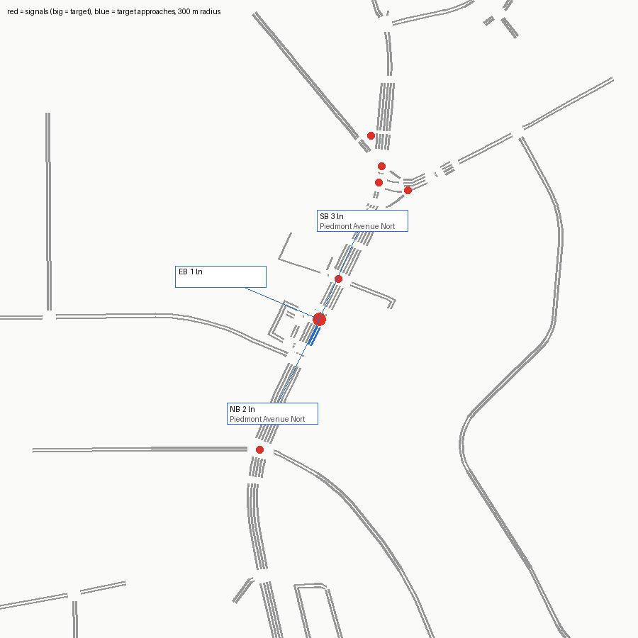

# SUMO network — signal 7431 (SR 237 @ Morningside Mill S/C)

Built from OpenStreetMap by `tools/osm_build.py`. ATSPM location 33.8068, -84.36659.

Target junction `12655833045` (traffic_light), 18.8 m from the ATSPM location.

## Approaches

| Approach | Street | Heading | Lanes | OSM lanes tag | OSM turn:lanes | Lane use (right→left) | Road upstream |
|---|---|---|---|---|---|---|---|
| NB | Piedmont Avenue Northeast | 26° | 2 | 5 |  | T LT | 97 m |
| EB |  | 113° | 1 | **missing** |  | LR | 0 m |
| SB | Piedmont Avenue Northeast | 204° | 3 | 5 |  | TR T T | 25 m |

## Flags

- OSM has no traffic_signals tag at this intersection; junction 12655833045 was made signalised by the script
- side leg(s) are driveways in OSM (service road(s) 561214163, 755124213, 1280110084, 1366532215, 1366532217, 1366532218, 1366532222); included as legs
- 1 other signalised junction(s) within 80 m (5411902638): may be one intersection split in OSM (e.g. divided road)
- SB approach has only 25 m of road before the network edge or the next signal (little queue space)
- EB approach (-1366532215#1): OSM way 1366532215 has no lanes tag; 1 lane(s) is a netconvert default
- EB approach has only 0 m of road before the network edge or the next signal (little queue space)
- NB approach has only 97 m of road before the network edge or the next signal (little queue space)
- ATSPM counts EB_T but the OSM EB approach has no 'T' movement
- ATSPM counts WB_L but OSM has no WB approach
- ATSPM counts WB_R but OSM has no WB approach
- ATSPM counts SB_L but the OSM SB approach has no 'L' movement
- netconvert printed 29 warning(s) (see netconvert.log)

## ATSPM movement → SUMO edges

| ATSPM column | From edge | To edge | Note |
|---|---|---|---|
| EB_T | -1366532215#1 |  | movement missing in OSM net |
| WB_L |  |  | no matching approach |
| WB_R |  |  | no matching approach |
| NB_T | 1141891561#1 | 1141891561#2 |  |
| SB_L | -1141891561#2 |  | movement missing in OSM net |
| SB_T | -1141891561#2 | -1141891561#1 |  |

## Smoke test

One flow per turning movement (120 veh/h each, 10 min) under netconvert's guessed signal program, run to 20 min.

- flows: 6, vehicles loaded 120, inserted 120, still running at 20 min 0
- teleports 0, collisions 0, SUMO warnings 0
- **PASS**

## What this network does not have

- The real signal timing (netconvert guesses a program; real plans: `tools/atspm_plans.py`).
- Lane counts or turn bays that OSM doesn't tag; see Flags. Verify against aerial imagery before trusting capacity results.
- Calibrated demand (the smoke test only checks every movement can be driven).
