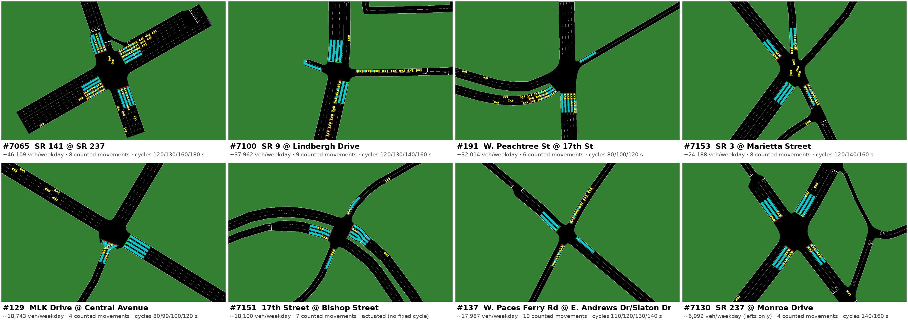

# Intersections — data collected (as of 2026-10-05)

Each intersection has: 7 days of 5-min turning-movement counts (GDOT ATSPM, 2026-09-26 to 2026-10-02), its real time-of-day signal timing plans (Split Monitor, 2026-10-02), a SUMO network from OpenStreetMap, and a SUMO simulation running the measured demand under the real timing.

| Signal | Intersection | Status | Count days (full) | Avg weekday vehicles | Movements counted | Timing plans (cycles, s) | Approaches | Signal vs recorded (median green error) | Sim check 07:00–09:30 |
|---|---|---|---|---|---|---|---|---|---|
| 7065 | SR 141 @ SR 237 | complete | 6 (2) | 46,109 | 8 | 5 (120/130/160/180) | 4 | 4.0 s | PASS: 6088/6127 entered, 0 teleports |
| 7100 | SR 9 @ Lindbergh Drive | accepted | 7 (4) | 37,962 | 9 | 4 (120/130/140/160) | 4 | 3.8 s | CHECK: 5498/5557 entered, 14 teleports |
| 191 | W. Peachtree St @ 17th St | accepted | 7 (3) | 32,014 | 6 | 5 (80/100/120) | 3 | 0.9 s | PASS: 4008/4053 entered, 0 teleports |
| 7153 | SR 3 @ Marietta Street | accepted | 7 (3) | 24,188 | 8 | 5 (120/140/160) | 4 | 2.8 s | PASS: 2836/2874 entered, 0 teleports |
| 129 | MLK Drive @ Central Avenue | accepted | 7 (5) | 18,743 | 4 | 6 (80/99/100/120) | 2 | 2.9 s | PASS: 3425/3456 entered, 0 teleports |
| 7151 | 17th Street @ Bishop Street | accepted | 7 (5) | 18,100 | 7 | 0 (–) + actuated | 4 | 6.4 s | PASS: 2172/2173 entered, 0 teleports |
| 137 | W. Paces Ferry Rd @ E. Andrews Dr/Slaton Dr | complete | 7 (5) | 17,987 | 10 | 4 (110/120/130/140) + actuated | 4 | 6.3 s | PASS: 1975/1988 entered, 0 teleports |
| 7130 | SR 237 @ Monroe Drive | accepted | 7 (3) | 6,992 (lefts only) | 4 | 4 (140/160) + actuated | 4 | 5.8 s | PASS: 4338/4383 entered, 0 teleports |

Signal: SUMO NEMA actuated-coordinated controller built from GDOT's real plans, measured min greens / clearances / max-outs / recall; the error is the mean absolute difference between simulated and recorded median green per phase (Timing & Actuation, 2026-10-02 08:00 and 17:00). Avg weekday vehicles = counted vehicle movements on complete weekdays only. Timing plans = verified plans (unverified reads excluded). Sim check: PASS = every vehicle entered, no teleports, no collisions.

Details per intersection: `intersections/<id>/sim/README.md` (assumptions, check), `timing/timing_plan_<id>.md`, `network/report.md`. Status of every signal checked (incl. rejected ones): `README.md`.
