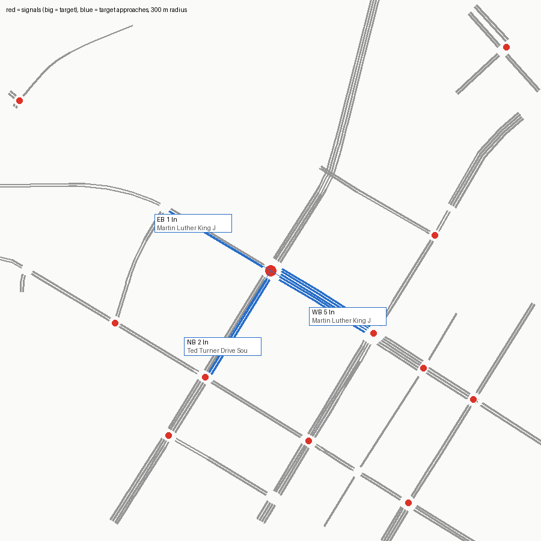

# SUMO network — signal 124 (Ted Turner Drive @ MLK Boulevard)

Built from OpenStreetMap by `tools-sumo/osm_build.py`. ATSPM location 33.7535209, -84.39479.

Target junction `11305241063` (traffic_light), 2.8 m from the ATSPM location.

## Approaches

| Approach | Street | Heading | Lanes | OSM lanes tag | OSM turn:lanes | Lane use (right→left) | Road upstream |
|---|---|---|---|---|---|---|---|
| NB | Ted Turner Drive Southwest | 32° | 2 | 4 |  | T LT | 135 m |
| EB | Martin Luther King Jr Drive Southwest | 121° | 1 | **missing** |  | LR | 341 m |
| WB | Martin Luther King Jr Drive Southwest | 301° | 5 | 5 |  | R T - L L | 125 m |

## Flags

- EB approach (Martin Luther King Jr Drive Southwest): OSM way 39441446 has no lanes tag; 1 lane(s) is a netconvert default
- NB approach (Ted Turner Drive Southwest): two-way way with lanes=4 total and no lanes:forward/backward; per-direction split guessed by netconvert
- OSM approach(es) NB have no ATSPM vehicle counts (no detector, or the compass labels differ from GDOT's)
- netconvert printed 15 warning(s) (see netconvert.log)

## ATSPM movement → SUMO edges

| ATSPM column | From edge | To edge | Note |
|---|---|---|---|
| EB_L | -39441446#1 | 1390568378 |  |
| EB_R | -39441446#1 | -1391666518 |  |
| WB_L | 1387050476#0 | -1391666518 |  |
| WB_T | 1387050476#0 | 39441446#0 |  |

Not mapped (not vehicle turning movements): BIKE_EB_T BIKE_WB_T EXIT_WB_T

## Smoke test

One flow per turning movement (120 veh/h each, 10 min) under netconvert's guessed signal program, run to 20 min.

- flows: 7, vehicles loaded 140, inserted 140, still running at 20 min 13
- teleports 0, collisions 0, SUMO warnings 0
- **CHECK**

## What this network does not have

- The real signal timing (netconvert guesses a program; real plans: `tools-timing/atspm_plans.py`).
- Lane counts or turn bays that OSM doesn't tag; see Flags. Verify against aerial imagery before trusting capacity results.
- Calibrated demand (the smoke test only checks every movement can be driven).
